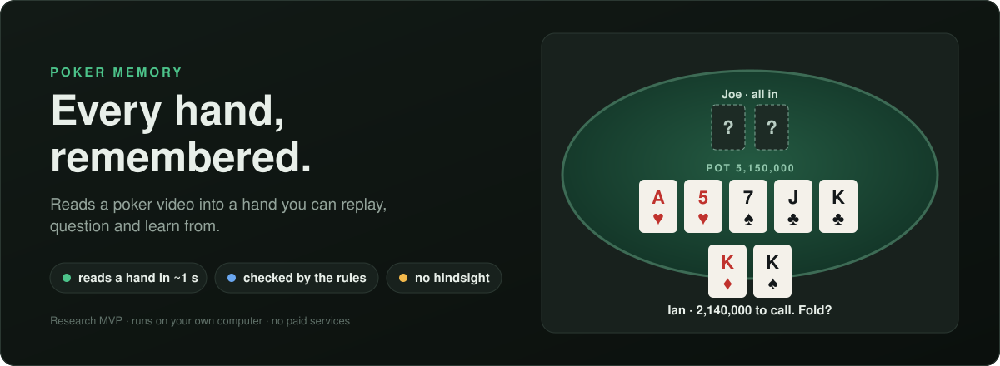
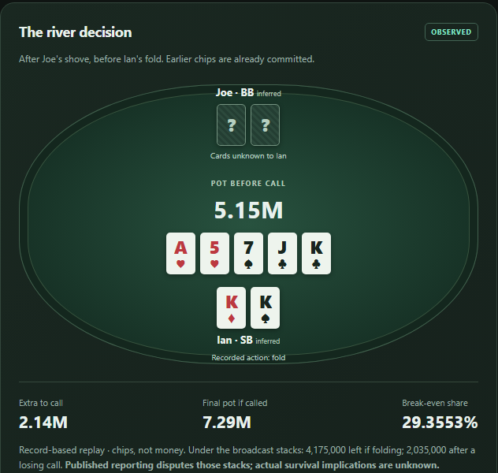
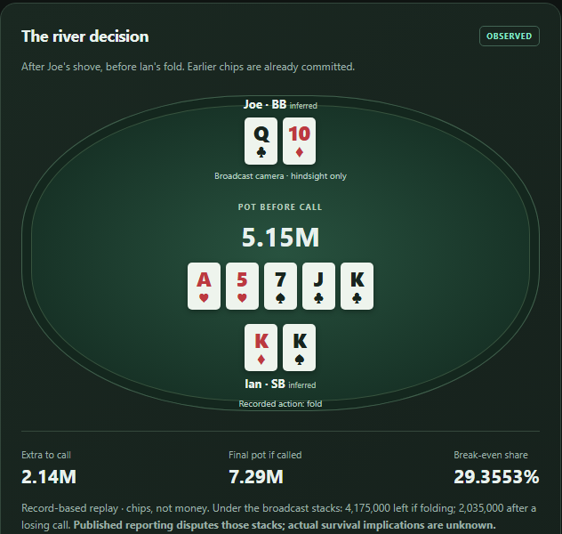
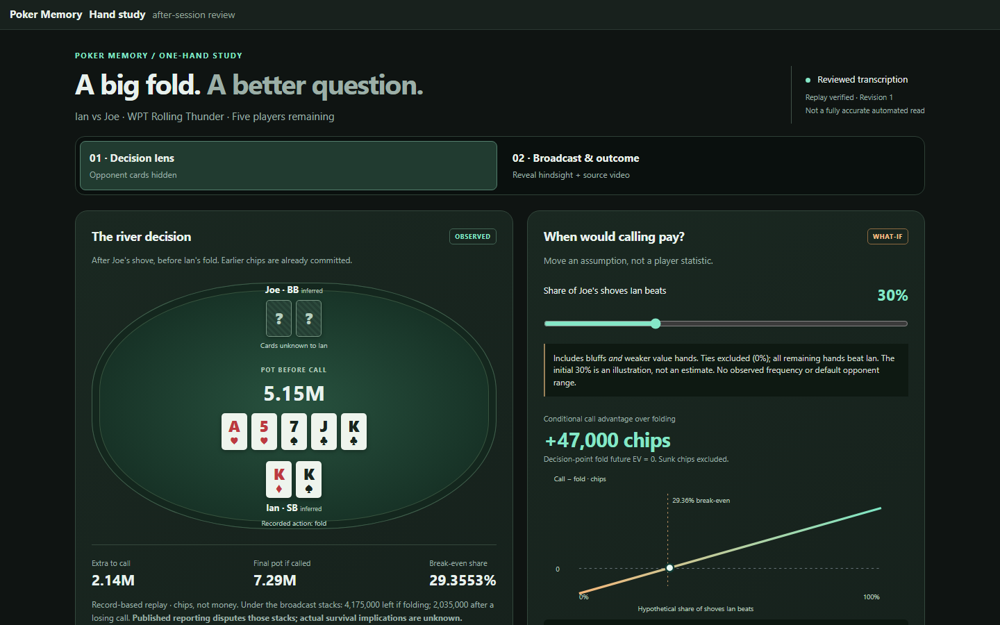
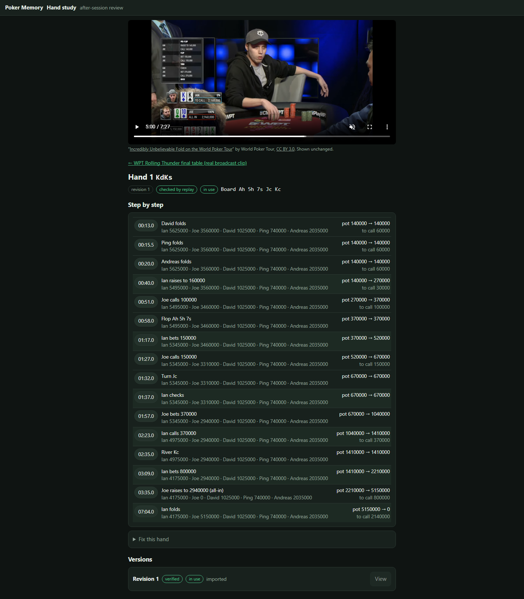
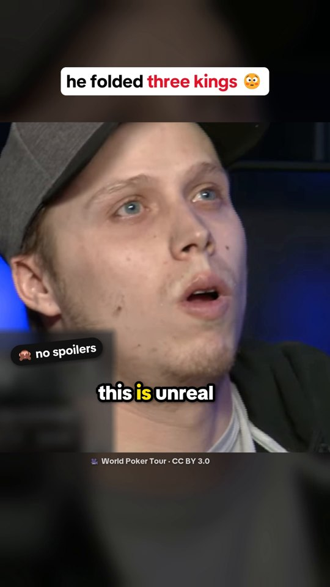
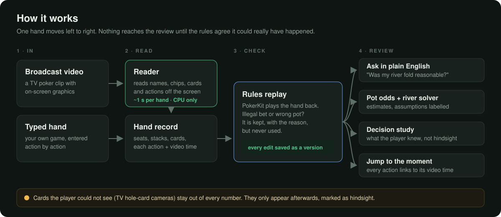
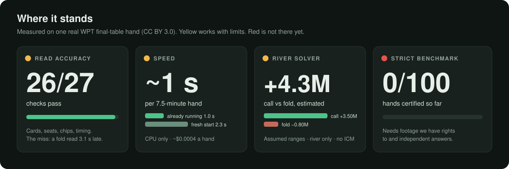

<p align="center">
  
</p>

# Poker Memory

**Every hand, remembered.**
Point it at a poker video, or type in your own hand. It turns the hand into a record the poker rules agree with, then helps you look back at the decisions that mattered.

> **Status: research MVP that runs on your own computer.** You can run it today on the included hands ([Use it](#use-it)).
> The automatic reader knows **one TV broadcast layout** and gets 26 of 27 checks right on one real hand.
> On a stricter 100-hand test, **0 hands are certified so far**. The solver numbers are **estimates under assumed ranges**, not proof.
> See [where it stands](#where-it-stands).

## Why

Most players remember the hands they lost and forget why. Reviewing a hand properly means knowing who bet what, when, how big the pot was, and what you could actually see at the time. Writing that down by hand is slow, and it's easy to get one chip count wrong and draw the wrong lesson.

Poker Memory keeps that record for you, checks it can really have happened, and keeps hindsight (cards you only saw later) out of the maths.

## What it does

| You want to… | Poker Memory… |
| --- | --- |
| Get a hand out of a video | Reads names, chips, cards and actions from the TV graphics, in about 1 second per hand on a CPU once it's running |
| Trust the record | Replays every hand with [PokerKit](https://github.com/uoftcprg/pokerkit). A hand with an illegal bet or a wrong pot is kept with the reason, but never used |
| Ask about a decision | Answers plain questions like *"Was my river fold reasonable? what if he bluffs 10%"* with pot odds, equity and labelled assumptions |
| Know what a move was worth | Estimates each river move (check, each bet size, call, fold) with a built-in two-player river solver |
| Study one decision fairly | Shows only what the player knew at that moment. The real outcome stays hidden until you ask for it |
| See it again | Every action links to its exact moment in the video |
| Fix a mistake | Every edit is saved as a new version. Only versions that replay correctly go into use |

## See it

### A real hand: the three-kings fold

From the World Poker Tour Rolling Thunder final table ([CC BY 3.0](#data-models-and-credits)). Ian holds K♦K♠ on A♥5♥7♠ J♣ K♣ and faces Joe's all-in: 2,140,000 more to call into 5,150,000. He folds.

| Decision view (what Ian knew) | Hindsight view (what really happened) |
| --- | --- |
|  |  |

A call needed Ian to be ahead **29.4%** of the time (2,140,000 ÷ 7,290,000). Under the solver's assumed ranges, calling scores about **4.3M chips** above folding. That is a model estimate, not a fact about what Joe holds. Joe actually had Q♣10♦ (a straight), so this time the fold saved Ian the 2,140,000 call.

The decision study lets you try out an assumption instead of guessing one: slide how often Joe's all-in is a hand Ian beats, and watch what calling would be worth.

<p align="center">
  
</p>

Every action in a hand links to its moment in the video:

<p align="center">
  
</p>

### The 78-second explainer

<a href="https://bennotben1224.github.io/poker-memory/tiktok/preview.html"></a>

A vertical short about this same fold, built from the analysis above with an open, scripted pipeline: captions timed to the voice, cards masked until the reveal, loudness checked.

- [Watch it in the browser](https://bennotben1224.github.io/poker-memory/tiktok/preview.html)
- [Download the MP4](https://github.com/BenNotBen1224/poker-memory/releases/download/v0.1.0/steinman-fold-tiktok.mp4) (1080×1920, 78.7 s)
- [How it's made](tiktok/README.md)

<br clear="right">

## Use it

Needs Python 3.12+ and Node 20+. These commands are for Windows PowerShell. On macOS or Linux use `.venv/bin/` instead of `.\.venv\Scripts\`.

```powershell
python -m venv .venv
.\.venv\Scripts\python.exe -m pip install -e ".[dev,video]"
.\.venv\Scripts\poker-memory.exe demo      # loads a sample home game
.\.venv\Scripts\poker-memory.exe ask "Was my river fold to the raise reasonable? what if he bluffs 10%"
.\.venv\Scripts\poker-memory.exe serve     # API on http://127.0.0.1:8000
```

You get an answer like this:

```text
Calling cost 55 to win a pot of 179, so a call needed 30.7% equity.
If 10% of his hands are bluffs you beat and the rest beat you, your equity is 10.0%.
Under this assumption the fold was reasonable: you needed 30.7% and had 10.0%.
```

The web app, in a second terminal:

```powershell
cd web
npm install
npm run build
npm run start                                # http://127.0.0.1:3000
```

Read a hand from the real clip automatically:

```powershell
.\.venv\Scripts\python.exe -m pip install -e ".[vision]"
.\.venv\Scripts\python.exe scripts\fetch_real_video.py     # downloads the CC BY 3.0 clip and checks its hash
.\.venv\Scripts\poker-memory.exe read examples\real\wpt_rolling_thunder_fold.webm
```

The full guide (entering your own sessions, the `/demo` decision study, fixing a hand, every question you can ask) is in [docs/GUIDE.md](docs/GUIDE.md).

## How it works

<p align="center">
  
</p>

- **Reader** (`src/poker_memory/reader/`). Decodes only the pictures where the TV graphics change (542 of 10,729 on the real clip), then reads each piece of text once with a 1.9 MB text model. Seats, the button and the blinds come from the order the graphics appear in, not from a seat detector.
- **Rules check** (`engine.py`, `store.py`). PokerKit replays the hand. Results go into SQLite with every version kept.
- **Answers** (`interpret.py`, `odds.py`, `memory.py`). Questions are matched by rules, not a language model. Every fact is labelled *observed*, *derived*, *estimated* or *unknown*.
- **River solver** (`solver.py`, `gto.py`, `handrank.py`, written here). Ranges come from the betting only, then the river is solved as a small game tree.

## Where it stands

<p align="center">
  
</p>

| Part | Status | What we know |
| --- | --- | --- |
| Rules check and version history | 🟢 Works | Every hand replayed by PokerKit. 285 tests pass (274 without the video). |
| Plain-English questions | 🟢 Works | Pot odds, equity, what-ifs, think time, video jumps. Unusual wording may not be understood. |
| Decision study (`/demo`) | 🟢 Works | Reviewed transcription of one real hand. Hindsight hidden by default. Not an automated read. |
| Fast reader, WPT layout | 🟡 Close | 26 of 27 checks; one fold timed 3.1 s late. 1.0 s when already running, 2.3 s from a fresh start. [Results](https://bennotben1224.github.io/poker-memory/results/fast-reader.html) |
| River solver | 🟡 Limited | Two-player rivers only. Ranges assumed from the betting. Ignores tournament payouts (ICM). [Results](https://bennotben1224.github.io/poker-memory/results/river-solver.html) |
| Other broadcast layouts | 🔴 Not yet | Work on a second layout is in progress and not ready. |
| 100-hand certified test | 🔴 Not yet | 0 of 100. Needs footage with clear reuse rights and independent answer keys. |

All results pages: **[bennotben1224.github.io/poker-memory/results](https://bennotben1224.github.io/poker-memory/results/)**. They include the [hand read by eye](https://bennotben1224.github.io/poker-memory/results/real-hand.html), frame by frame, that the reader is checked against.

## Run the checks

```powershell
.\.venv\Scripts\python.exe -m pytest -q tests                                      # all tests
.\.venv\Scripts\python.exe scripts\check_fast_read.py examples\real\wpt_rolling_thunder.yaml   # reader vs the hand read by eye
.\.venv\Scripts\python.exe scripts\bench_fast_read.py examples\real\wpt_rolling_thunder_fold.webm   # fresh and warm timings
.\.venv\Scripts\python.exe -m pytest tests\test_solver.py tests\test_gto.py         # river solver
```

The reader checks need the real clip (`scripts\fetch_real_video.py`) and the `vision` extra. Without the clip, the tests that need it are skipped. `check_fast_read.py` currently prints `26 of 27 checks pass` and exits with code 1 because of the known late fold.

## What's next

- Read more broadcast layouts, and earn a real score on the 100-hand test.
- Enter hands by voice at the table.
- Player notes that carry across sessions.
- Solve the turn and earlier streets, not just the river.

## Repo map

```text
src/poker_memory/        the app: hand model, rules check, store, questions, solver, API, CLI
src/poker_memory/reader/ the video reader and its text model (with NOTICE)
web/                     Next.js web app: sessions, hand pages, /demo decision study
scripts/                 fetch the clip, check and time the reader, frame tools
tests/                   pytest suite
examples/                a synthetic home game and the real WPT hand, read by eye
results/                 results pages (served on GitHub Pages)
tiktok/                  the explainer video pipeline, its checks and fonts
docs/                    GUIDE.md and the images used here
```

## Data, models and credits

- **Video:** "Incredibly Unbelievable Fold on the World Poker Tour" by World Poker Tour, [CC BY 3.0](https://creativecommons.org/licenses/by/3.0/), via [Wikimedia Commons](https://commons.wikimedia.org/wiki/File:Incredibly_Unbelievable_Fold_on_the_World_Poker_Tour.webm). Not stored in git; `scripts/fetch_real_video.py` downloads it and checks its hash. Stills, crops and the explainer are edited from it (cropped, resized, masked, captioned).
- **Text model:** PaddleOCR's English recogniser, Apache-2.0. See `src/poker_memory/reader/models/NOTICE`.
- **Rules engine:** [PokerKit](https://github.com/uoftcprg/pokerkit), MIT.
- **Fonts in the explainer:** TikTok Sans and Montserrat, SIL Open Font License (`tiktok/fonts/`).
- `examples/home_game.yaml` is made up: fictional players and a generated video.

## License

No license has been chosen yet. Until one is added, all rights are reserved. Third-party material above keeps its own license.
