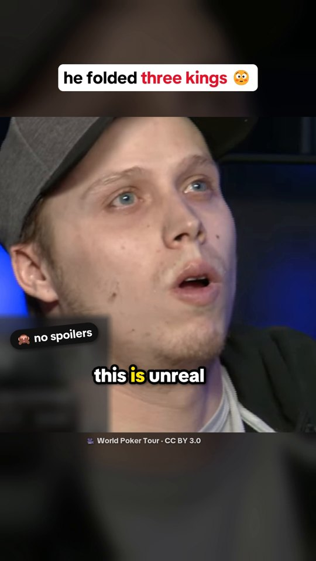

# The TikTok: "he folded three kings"

A 79-second vertical video about Ian Steinman's river fold at the WPT Rolling Thunder final table. Every frame comes from code in this folder: the cuts, captions, card graphics, sound effects and mix.

- **Watch it:** [steinman-fold-tiktok.mp4](https://github.com/BenNotBen1224/poker-memory/releases/download/v0.1.0/steinman-fold-tiktok.mp4) (release v0.1.0, 30.1 MB, 1080×1920)
- **See the chapters and checks:** [preview page](https://bennotben1224.github.io/poker-memory/tiktok/preview.html)
- **sha256:** `936bfb51498aad8149405ee3f3dae970bdc3184a413dbf895cb167a110dd8bb0`



## What's in the video

| Part | Where it comes from |
| --- | --- |
| Picture and commentary | The WPT clip, cut into short pieces ([credit](#credits)) |
| Captions | Commentary words, shown only when two or more speech-to-text runs agree |
| Card and chip graphics | Drawn by `gfx.py` and `scenes.py` |
| Sound effects | Made from scratch by `sfx.py`. No samples, no music |
| Facts on screen | Each one has a source link on the preview page |

Joe's cards stay hidden until the reveal at 61.7 s. `verify.py` checks this on every frame of the finished file.

## Rebuild it

You need Windows: the graphics use the Segoe UI Emoji and Segoe UI Symbol fonts in `C:\Windows\Fonts`. The other fonts are in `fonts/`.

```powershell
python scripts/fetch_real_video.py          # from the repo root: the WPT clip, checked by sha1
pip install av numpy scipy pillow opencv-python fonttools pyloudnorm faster-whisper onnxruntime huggingface_hub
cd tiktok
python precheck.py        # audio-only dry run of the checks, before the long render
python render.py          # out/steinman-fold-tiktok.mp4, about 4 min on an 8-core machine
python verify.py          # checks the file itself, writes out/verify.txt
python make_preview.py    # preview.html, poster and chapter thumbnails
```

`verify.py` loads the Whisper `medium.en` model only from the local cache. Run `python transcribe.py medium.en` once to download it.

## What `verify.py` checks

The saved result is in [out/verify-final.txt](out/verify-final.txt). Every check passed on the released file:

- 1,887 frames decode, and each one maps back to the source frame it came from
- Hole cards are masked in all 1,479 frames before the reveal
- No spoiler words in any voice clip before the reveal, and no commentator names
- Loudness is −14.15 LUFS with a true peak of −1.25 dBTP
- Audio lines up with the timeline (0 ms lag)
- Each caption appears within 0.025 s of its spoken word (worst median)

## Files

| File | Job |
| --- | --- |
| `timeline.py` | The edit list: segments, voice clips, and which source frame each output frame uses |
| `scenes.py`, `overlays.py`, `gfx.py` | Everything drawn on top of the video |
| `captions.py`, `align.py`, `hook_words.py` | Caption text and word timing |
| `mix.py`, `sfx.py` | The audio mix and the made-from-scratch sound effects |
| `render.py` | Puts it all together into the MP4 |
| `precheck.py`, `verify.py`, `edges.py`, `verify_lines*.py` | Checks |
| `transcribe.py`, `detect_cuts.py`, `contact_sheet.py`, `grid_frames.py`, `strip.py` | Planning helpers used while writing the edit |
| `plan/` | Transcripts, cut points and word timings the edit was built from |
| `out/` | The poster, chapter thumbnails and check results for the released file |

## Credits

- Video and commentary: ["Incredibly Unbelievable Fold on the World Poker Tour"](https://commons.wikimedia.org/wiki/File:Incredibly_Unbelievable_Fold_on_the_World_Poker_Tour.webm) by World Poker Tour, [CC BY 3.0](https://creativecommons.org/licenses/by/3.0/). Cut, captioned, overlaid and remixed here.
- Fonts: TikTok Sans and Montserrat, both under the SIL Open Font License (`fonts/*-OFL.txt`).
- Speech models: [faster-whisper](https://github.com/SYSTRAN/faster-whisper) and [wav2vec2-base-960h](https://huggingface.co/Xenova/wav2vec2-base-960h), downloaded when the scripts run. They are not stored here.
